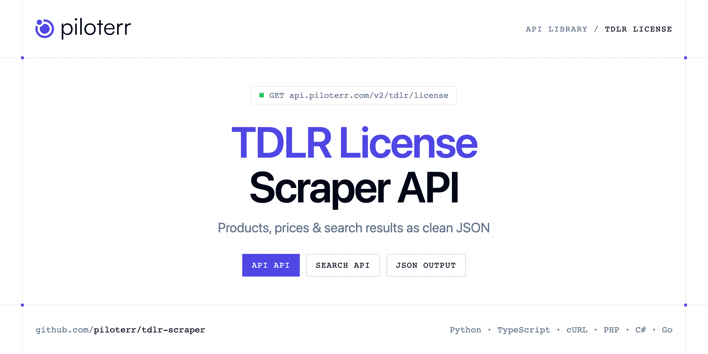

<p align="center">
  <a href="https://www.piloterr.com"></a>
</p>

# TDLR License Scraper API

[](https://discord.gg/CFj3ph8aHU) [](https://app.piloterr.com) [](https://app.piloterr.com/openapi) [](LICENSE)

The **Piloterr TDLR License Scraper API** lets you extract public data from TDLR License as **clean, structured JSON** — no proxies, headless browsers or HTML parsing to maintain. Endpoints available in production:

- **TDLR License API** — Fetch one TDLR license by detail id or SearchResultDetail URL, including status, subtype, DBA, and notes.
- **TDLR License Search API** — Search Texas TDLR licenses by name, city, county, or ZIP.

Use it for price monitoring, assortment tracking, competitor analysis, product research or catalog enrichment.

| Endpoint | Path | Credits | What you get |
|---|---|---|---|
| [TDLR License API](#tdlr-license-api) | `/v2/tdlr/license` | 1 | Fetch one TDLR license by detail id or SearchResultDetail URL, including status, subtype, DBA, and notes. |
| [TDLR License Search API](#tdlr-license-search-api) | `/v2/tdlr/search` | 1 | Search Texas TDLR licenses by name, city, county, or ZIP. license_type such as AIRREF is required for a useful search. 25 rows per page. |

## Table of contents

- [How it works](#how-it-works)
- [TDLR License API](#tdlr-license-api)
- [TDLR License Search API](#tdlr-license-search-api)
- [Code examples in other languages](#code-examples-in-other-languages)
- [Practical use cases](#practical-use-cases)
- [Why Piloterr?](#why-piloterr)
- [FAQ](#faq)
- [Related scrapers](#related-scrapers)
- [Support](#support)

## How it works

1. **Create a free Piloterr account** and copy your API key from the [dashboard](https://app.piloterr.com).
2. **Send a `GET` (or `POST`) request** to `https://api.piloterr.com/v2/...` with the header `x-api-key: YOUR_API_KEY`.
3. **Receive structured JSON** — Piloterr handles rendering, proxies, retries and parsing.

```bash
export PILOTERR_API_KEY="your-api-key"
pip install requests        # Python
# TypeScript: Node.js 18+ (native fetch), run with `npx tsx file.ts`
```

> Every endpoint accepts both `GET` (query string) and `POST` (JSON body with the same fields).

## TDLR License API

Fetch one TDLR license by detail id or SearchResultDetail URL, including status, subtype, DBA, and notes.

`GET | POST https://api.piloterr.com/v2/tdlr/license` · **1 credit per request** · [Full reference](https://app.piloterr.com/openapi)

### Request parameters

| Parameter | Type | Required | Description |
|---|---|---|---|
| `query` | string | ✅ | Required. Detail id, example AIRREF00000564, or the SearchResultDetail URL from search. |

### Python example

```python
import json
import os
import requests

response = requests.get(
    "https://api.piloterr.com/v2/tdlr/license",
    headers={"x-api-key": os.environ["PILOTERR_API_KEY"]},
    params={
        "query": "https://www.tdlr.texas.gov/LicenseSearch/SearchResultDetail.asp?1=AIRREF00000564",
    },
    timeout=120,
)
response.raise_for_status()
data = response.json()

print(json.dumps(data, indent=2, ensure_ascii=False)[:2000])
```

### TypeScript example

```typescript
type TdlrLicense = {
  dba?: string;
  url?: string;
  city?: unknown;
  name?: string;
  notes?: string[];
  phone?: unknown;
  county?: string;
  status?: string;
  subtype?: string;
  detail_id?: string;
  postal_code?: unknown;
  license_type?: string;
  business_name?: string;
  license_number?: string;
  expiration_date?: string;
  license_type_code?: string;
  original_issue_date?: string;
};

const params = new URLSearchParams({
  "query": "https://www.tdlr.texas.gov/LicenseSearch/SearchResultDetail.asp?1=AIRREF00000564",
});

const response = await fetch(`https://api.piloterr.com/v2/tdlr/license?${params}`, {
  headers: { "x-api-key": process.env.PILOTERR_API_KEY! },
});
if (!response.ok) throw new Error(`Piloterr error ${response.status}: ${await response.text()}`);

const data = (await response.json()) as TdlrLicense;

console.log(JSON.stringify(data, null, 2).slice(0, 2000));
```

<details>
<summary><b>POST variant</b></summary>

```http
POST https://api.piloterr.com/v2/tdlr/license
x-api-key: YOUR_API_KEY
Content-Type: application/json

{"query": "https://www.tdlr.texas.gov/LicenseSearch/SearchResultDetail.asp?1=AIRREF00000564"}
```
</details>

### Output example

Example response from the API reference, abridged — real values depend on the page you scrape.

```json
{
  "dba": "JIMMY'S AIR CONDITIONING & HEATING",
  "url": "https://www.tdlr.texas.gov/LicenseSearch/SearchResultDetail.asp?1=AIRREF00000564",
  "city": null,
  "name": "SMITH, JAMES CHARLES JR",
  "notes": [
    "No Public Contracting"
  ],
  "phone": null,
  "county": "FORT BEND",
  "status": "Active",
  "subtype": "AE",
  "detail_id": "AIRREF00000564",
  "postal_code": null,
  "license_type": "Air Conditioning/Refrigeration Contractor",
  "business_name": "JIMMY'S AIR CONDITIONING & HEATING",
  "license_number": "TACLA00000564E",
  "expiration_date": "12/24/2026",
  "license_type_code": "AIRREF",
  "original_issue_date": "08/16/1984"
}
```

### Response fields

| Field | Type | Description |
|---|---|---|
| `dba` | string |  |
| `url` | string |  |
| `city` | object |  |
| `name` | string |  |
| `notes` | string[] |  |
| `phone` | object |  |
| `county` | string |  |
| `status` | string |  |
| `subtype` | string |  |
| `detail_id` | string |  |
| `postal_code` | object |  |
| `license_type` | string |  |
| `business_name` | string |  |
| `license_number` | string |  |
| `expiration_date` | string |  |
| `license_type_code` | string |  |
| `original_issue_date` | string |  |

## TDLR License Search API

Search Texas TDLR licenses by name, city, county, or ZIP. license_type such as AIRREF is required for a useful search. 25 rows per page.

`GET | POST https://api.piloterr.com/v2/tdlr/search` · **1 credit per request** · [Full reference](https://app.piloterr.com/openapi)

### Request parameters

| Parameter | Type | Required | Description |
|---|---|---|---|
| `query` | string | — | Optional when city, county, or postal_code is set. Person or business name, example SMITH. A detail URL is rejected. |
| `license_type` | string | — | Optional on the request, required for a useful search. License type code, example AIRREF for air conditioning contractors. ALL or blank searches every type. |
| `city` | string | — | Optional. Business city. Example: Austin. One of query, city, county, or postal_code is required. |
| `county` | string | — | Optional. Business county. Example: TRAVIS. |
| `postal_code` | string | — | Optional. Business ZIP. Example: 78701. |
| `page` | number | — | Optional. Page number starting at 1. Example: 2. Defaults to 1. Each page has 25 rows. |

### Python example

```python
import json
import os
import requests

response = requests.get(
    "https://api.piloterr.com/v2/tdlr/search",
    headers={"x-api-key": os.environ["PILOTERR_API_KEY"]},
    params={
        "city": "Austin. One of query, city, county, or postal_code is required.",
    },
    timeout=120,
)
response.raise_for_status()
data = response.json()

print(json.dumps(data, indent=2, ensure_ascii=False)[:2000])
```

### TypeScript example

```typescript
type TdlrLicenseSearch = {
  results?: {
    dba?: unknown;
    url?: string;
    city?: unknown;
    name?: string;
    notes?: unknown[];
    phone?: unknown;
    county?: string;
    status?: unknown;
    subtype?: unknown;
    detail_id?: string;
    postal_code?: unknown;
    license_type?: string;
    business_name?: string;
    license_number?: string;
    expiration_date?: string;
    license_type_code?: string;
    original_issue_date?: unknown;
  }[];
  pagination?: {
    next?: string;
    page?: number;
    per_page?: number;
    total_pages?: number;
    total_results?: number;
  };
};

const params = new URLSearchParams({
  "city": "Austin. One of query, city, county, or postal_code is required.",
});

const response = await fetch(`https://api.piloterr.com/v2/tdlr/search?${params}`, {
  headers: { "x-api-key": process.env.PILOTERR_API_KEY! },
});
if (!response.ok) throw new Error(`Piloterr error ${response.status}: ${await response.text()}`);

const data = (await response.json()) as TdlrLicenseSearch;

console.log(JSON.stringify(data, null, 2).slice(0, 2000));
```

<details>
<summary><b>POST variant</b></summary>

```http
POST https://api.piloterr.com/v2/tdlr/search
x-api-key: YOUR_API_KEY
Content-Type: application/json

{"city": "Austin. One of query, city, county, or postal_code is required."}
```
</details>

### Output example

Example response from the API reference, abridged — real values depend on the page you scrape.

```json
{
  "results": [
    {
      "dba": null,
      "url": "https://www.tdlr.texas.gov/LicenseSearch/SearchResultDetail.asp?1=AIRREF00000564",
      "city": null,
      "name": "SMITH, JAMES CHARLES JR",
      "notes": [],
      "phone": null,
      "county": "FORT BEND",
      "status": null,
      "subtype": null,
      "detail_id": "AIRREF00000564",
      "postal_code": null,
      "license_type": "Air Conditioning Contractors",
      "business_name": "JIMMY'S AIR CONDITIONING & HEATING",
      "license_number": "TACLA00000564E",
      "expiration_date": "12/24/2026",
      "license_type_code": "AIRREF",
      "original_issue_date": null
    }
  ],
  "pagination": {
    "next": "https://www.tdlr.texas.gov/LicenseSearch/SearchResultsListBrowse.asp?from=search&pht_oth_name=SMITH&tdlr_status=AIRREF&page=2",
    "page": 1,
    "per_page": 25,
    "total_pages": 7,
    "total_results": 153
  }
}
```

### Response fields

| Field | Type | Description |
|---|---|---|
| `results[]` | object[] |  |
| `results[].dba` | object |  |
| `results[].url` | string |  |
| `results[].city` | object |  |
| `results[].name` | string |  |
| `results[].notes` | any[] |  |
| `results[].phone` | object |  |
| `results[].county` | string |  |
| `results[].status` | object |  |
| `results[].subtype` | object |  |
| `results[].detail_id` | string |  |
| `results[].postal_code` | object |  |
| `results[].license_type` | string |  |
| `results[].business_name` | string |  |
| `results[].license_number` | string |  |
| `results[].expiration_date` | string |  |
| `results[].license_type_code` | string |  |
| `results[].original_issue_date` | object |  |
| `pagination` | object |  |
| `pagination.next` | string |  |
| `pagination.page` | integer |  |
| `pagination.per_page` | integer |  |
| `pagination.total_pages` | integer |  |
| `pagination.total_results` | integer |  |

## Code examples in other languages

Ready-to-run examples live in the [`examples/`](examples) folder. Each one reads your key from the `PILOTERR_API_KEY` environment variable.

| Language | API | Search |
|---|---|---|
| cURL (Bash) | [`license`](examples/curl/license.sh) | [`search`](examples/curl/search.sh) |
| PHP | [`license`](examples/php/license.php) | [`search`](examples/php/search.php) |
| C# | [`license`](examples/csharp/License.cs) | [`search`](examples/csharp/Search.cs) |
| Go | [`license`](examples/go/license.go) | [`search`](examples/go/search.go) |
| Java | [`license`](examples/java/LicenseExample.java) | [`search`](examples/java/SearchExample.java) |
| Ruby | [`license`](examples/ruby/license.rb) | [`search`](examples/ruby/search.rb) |
| Node.js | [`license`](examples/nodejs/license.mjs) | [`search`](examples/nodejs/search.mjs) |

## Practical use cases

- **Price monitoring** — Track prices, promotions and availability over time to react to competitors.
- **Assortment & catalog tracking** — Follow new products, delisted items and category changes.
- **Competitor analysis** — Benchmark ranges, brands and positioning across retailers.
- **Product research** — Spot best-sellers and trends from search results.
- **Catalog enrichment** — Pull titles, images and attributes into your PIM or marketplace listings.

## Why Piloterr?

- **No infrastructure** — no proxies, headless browsers or CAPTCHA solving to run yourself.
- **Structured JSON** — stable, documented fields instead of brittle HTML selectors.
- **Pay per request** — transparent credit cost per endpoint, failed requests are retried for you.
- **One API key, hundreds of sources** — TDLR License plus many other e-commerce, search and company data endpoints in the [Piloterr library](https://www.piloterr.com/library).
- **Any language** — plain HTTPS + JSON, with examples for Python, TypeScript, cURL, PHP, C#, Go, Java, Ruby and Node.js.

## FAQ

### Is it legal to scrape TDLR License?

Collecting publicly available data is generally allowed in many jurisdictions, but rules depend on your country, the data you collect and how you use it. Avoid personal data unless you have a lawful basis, respect the website's terms where they apply, and get legal advice for your specific use case. This is not legal advice.

### Do I need proxies or a headless browser?

No. Piloterr handles rendering, proxy rotation and retries on its side. You only send an HTTPS request with your `x-api-key` header and receive JSON.

### How much does a request cost?

Credits per call: `/v2/tdlr/license` **1**, `/v2/tdlr/search` **1**. See the [Piloterr website](https://www.piloterr.com) for plans.

### What data does the TDLR License API return?

Each endpoint returns structured JSON: **TDLR License** — `dba`, `url`, `city`, `name`, `notes`, `phone`; **TDLR License Search** — `results[]`, `results[].dba`, `results[].url`, `results[].city`, `results[].name`, `results[].notes`.

### How do I paginate TDLR License results?

Use the `page` parameter and keep requesting while the response indicates more results.

### Which languages are supported?

Any language that can make an HTTP request. This README shows Python and TypeScript; the [`examples/`](examples) folder contains cURL, PHP, C#, Go, Java, Ruby and Node.js.

## Related scrapers

- [About You Scraper API](https://github.com/piloterr/aboutyou-scraper)
- [Action Scraper API](https://github.com/piloterr/action-scraper)
- [Aldi Scraper API](https://github.com/piloterr/aldi-scraper)
- [Alibaba Scraper API](https://github.com/piloterr/alibaba-scraper)
- [AliExpress Scraper API](https://github.com/piloterr/aliexpress-scraper)
- [Allegro Scraper API](https://github.com/piloterr/allegro-scraper)
- [All Piloterr scrapers on GitHub](https://github.com/piloterr)

## Support

- 💬 Join the [Piloterr Discord](https://discord.gg/CFj3ph8aHU) to ask questions and share what you build.
- 📚 Browse the [API reference (OpenAPI)](https://app.piloterr.com/openapi) and the [Piloterr library](https://www.piloterr.com/library).
- 🔑 [Get your API key](https://app.piloterr.com).

---

<p align="center">
  <a href="https://www.piloterr.com">
    <picture>
      <source media="(prefers-color-scheme: dark)" srcset="images/logo-dark.svg">
      
    </picture>
  </a>
  <br>
  <sub>Built by <a href="https://www.piloterr.com">Piloterr</a> — web scraping APIs for e-commerce, search, real estate and more, one API key.</sub>
</p>

<sub>TDLR License is a trademark of its respective owner. This repository is not affiliated with or endorsed by TDLR License. Examples are released under the MIT license.</sub>
